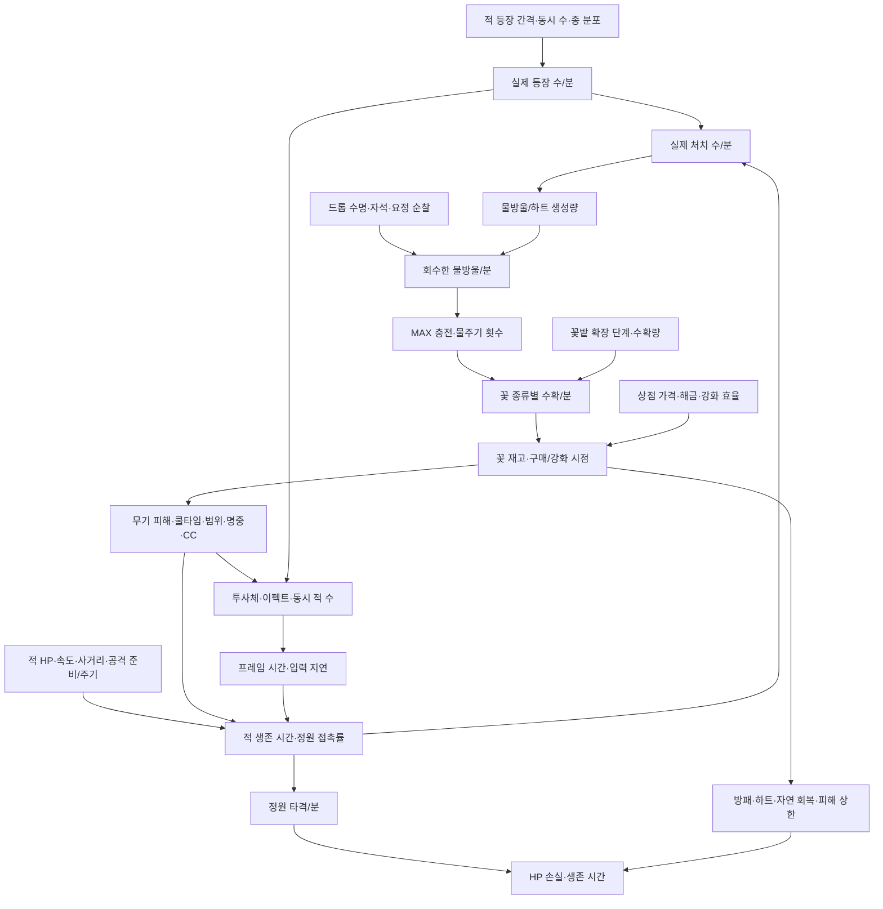

# Garden Survivors — 밸런스 의존관계·상하한·플레이어 직관 검토 (v0.1)

- 기준: `devel` 커밋 `d5dac58`, 2026-11-22.
- 목적: 앞서 정리한 [전체 수치 목록](./balance-parameter-inventory.md) 중 **서로 독립적으로 바꾸면 안 되는 값**과 **정상 동작/직관/성능 검증 규칙**을 식별한다.
- 관련: [All Aboard! 기준 경험 목표 정의](./balance-goals-benchmark.md), [현행 수확 경제 기준](./garden-expansion-balance.md).
- **이번 문서는 진단 문서다.** 게임의 수치·로직을 변경하거나 새로운 목표를 확정하지 않는다.
- 규칙 분류: **H = 논리상 반드시 만족할 제약**, **S = 플레이어 기대·장르 관습 기반 상대적 일관성(예외 가능)**, **T = 이 게임에서 별도 실험할 경고선(보편 표준 아님)**, **R = 현행 코드의 위험·검토사항**.

## 1. 핵심 원리 — 세 가지 제약을 혼동하지 않는다

**논리 제약(H)**은 엔진/경제가 깨지지 않기 위한 절대 조건이다. 예: `0 < 최소속도 ≤ 기본속도 ≤ 최대속도`, `확률 합계 = 1`, `모든 강화 단계의 지출은 0 이상`, `물통 충전 ≤ MAX`.

**직관 제약(S)**은 캐릭터의 외형·서사·역할·동작에 관한 것이다. 일반적인 '느린 애벌레와 빠른 나비', '크고 무거운 적의 예고 있는 공격', '투척 무기의 빠른 회전' 같은 기대를 사용하되, 예외는 특수 기술·시각적 피드백으로 설명할 수 있다. **생물학적 실제 속도나 모든 게임에 적용되는 초당 회전수 정답은 없다.**

**실험 경고선(T)**은 관찰이 필요한 항목을 선별하는 용도다. 수치가 범위를 벗어났다고 자동으로 '틀렸다'고 판단하지 않는다. 화면 크기·프레임·무기 모션·다수 적 겹침을 함께 시험한다.

## 2. 밸런스 변수의 종속 그래프



**피드백 루프**: 적이 많다 → 처치 기회가 늘어난다 → 물 획득이 늘어난다 → 꽃을 수확한다 → 무기를 산다 → 처치가 빨라진다. 반대로 적 HP와 속도가 증가하면 실제 처치율이 떨어지고 물 공급 및 성장까지 느려질 수 있다. 이 두 작용을 별도로 시험해야 한다. '적을 2배 늘리면 경제 수입도 2배'는 성립하지 않는다.

## 3. 적 12종: 속도·체력·공격 역할의 직관

| 계열 | Lv1 | Lv2 | Lv3 | 역할 기대와 확인사항 |
|---|---|---|---|---|
| 느린 접근형 | 애벌레 **20px/s, HP10** | 풍뎅이 **26, HP20** | 생쥐 **36, HP30** | 등급 상승에 따라 빠르고 단단해지는 기준. 애벌레의 둔한 동작은 유지 |
| 점프형 | 메뚜기 **36, HP10** | 개구리 **38, HP20** | 토끼 **44, HP30** | 빠른 접근 대신 점프 준비·공중 무기 상성으로 제어 |
| 돌진형 | 공벌레 **24, HP12** | 고양이 **30, HP24** | 불독 **36, HP36** | 기본 이동은 반드시 최고일 필요 없음. 긴 돌진 사거리와 높은 HP가 위협 |
| 비행형 | 나비 **40, HP8** | 참새 **46, HP16** | 비둘기 **48, HP24** | 동급 대비 빠르고 약하지만 일부 지상 무기로 공격 불가 |

**현재 속도의 상대 관계는 직관과 대체로 일치한다.** 예: 나비(40) > 애벌레(20), 참새(46) > 풍뎅이(26), 비둘기(48) > 생쥐(36). 네 계열 모두 계열 내 Lv1→Lv3 기본 속도와 기본 HP가 단조 증가한다. 이는 **현재 코드값에 대한 검사**이지 반드시 이렇게 되어야 하는 전 장르 규칙은 아니다.

검사 규칙:

- **H:** 기본속도>0, HP>0, 준비/타격/회복시간>0. 적의 실제 이동속도는 상한 이하. `approachTime≈유효 진입거리/실제 이동속도`를 출현 위치별로 계산.
- **S:** 빠른 적은 낮은 HP·짧은 사거리·약한 공격·긴 예고 중 **최소 하나**로 상쇄하거나, 강한 적은 위험성을 별도 시각 효과로 알린다. '빠름·높은 HP·큰 공격력·긴 사거리'를 동시에 올리면 위협이 급상승한다.
- **S:** 같은 계열에서 상위 등급의 속도/HP가 하위 등급보다 낮아질 때는 '무거운 상위형', '빠른 초급 암살자' 같은 디자인상의 설명을 남긴다. 다른 계열끼리는 엄격한 속도 순서가 필요 없다.
- **S:** 날개·다리 애니메이션 주파수(`hz`)와 실제 이동 속도(`px/s`)는 같은 값이 아니다. 나비의 `4.8Hz`, 참새의 `5.2Hz`는 **작은 움직임의 진동 빈도**이지 몸 전체가 매초 5회 회전한다는 뜻이 아니다.
- **T:** 같은 계열 내 기본 속도 차이가 2배를 크게 넘거나, 동급 비행형이 느린 기어가는 유닛보다 확연히 느린 경우 **경고**. 캐릭터 설명·실제 진입 경로·모션 확인 후 결정. 2배는 이 프로젝트의 첫 검토선이지 보편 법칙이 아니다.
- **T:** 적 공격 사전 예고가 `0.15초` 미만이면 화면 밀도와 대응 가능성을 특별 검토. 현재 준비 모션은 **0.23~0.52초**. 사람이 공격에 직접 반응하도록 설계할수록 더 긴 예고가 필요할 수 있다.
- **H/S:** 초당 타격 수는 '이동 속도'와 별개. 현행 공격 사이클은 `windup + strike + 0.55 + 0.80`초로 종별 **1.81~2.25초/회**(접근 이후), 약 **0.44~0.55회/초**다. 5회/초 공격 같은 값은 현행 규칙이 아니다.

### 역할을 지우지 않는 성능 교환관계

| 올리는 값 | 동시에 살펴야 하는 값 | 왜 연결되는가 |
|---|---|---|
| 적 속도 ↑ | 적 HP, 예고 시간, 유효 사거리, 저지 수단 | 처치 가능한 시간이 줄어듦 |
| 적 HP ↑ | 기존 무기 TTK, 물방울/분, 무기 구매 간격 | 처치량·재화 수입이 동반 감소 가능 |
| 적 공격 거리 ↑ | 이동 거리, 선공 위험, 타격/분 | 정원까지 완전히 도착하기 전 압박 가능 |
| 비행 적 비율 ↑ | 지상 무기 비율, 공중 공격 가능 무기 해금 | 같은 HP여도 실효 생존력 증가 가능 |
| 돌진 속도 ↑ | 돌진 전 예고, 넉백 면역, 방어력, 정원 피해 | 일반 이동보다 순간 반응이 더 어려움 |
| 강한 적 해금 시간 앞당김 | 초반 무기 해금 및 수확/구매 시간 | 대응책 없이 맞닥뜨리는 상황 예방 |

## 4. 무기 회전: '초당 다섯 바퀴'는 무엇을 도는가?

`회전수(회/s) = 각속도(rad/s)/(2π)`이고, 미끄러지지 않는 원형 바퀴는 `회전수 = 전진속도/(2π×반지름)`이다.

| 게임 오브젝트 | 현행 회전값 | 초당 회전 | 검토 판정 |
|---|---|---:|---|
| 스프링클러 헤드 | 4 rad/s | **0.64회/초** | 자연스러운 수준, 3방향 살수 연출과 대조 |
| 빗자루 중심 공전 | 1.2초/회 | **0.83회/초** | 공전이므로 빗자루 자체 자전과 구분 |
| 부메랑 | 18 rad/s | **2.86회/초** | 빨리 도는 투척물로 설명 가능 |
| 돌멩이 | 4 rad/s | **0.64회/초** | 가벼운 투척 회전 |
| 탱탱볼 | 7 rad/s | **1.11회/초** | 회전과 실제 튕김 주기는 독립 |
| 바퀴(출발) | 속도 420px/s, 반지름 14px | **4.77회/초** | **우선 시각 검토**: 물리적으로 맞지만 작은 SVG가 과도하게 돌 수 있음 |
| 바퀴(최저 속도) | 속도 180px/s, 반지름 14px | **2.05회/초** | 감속과 회전이 일치 |

- **H(물리 일관성 선택 시):** 굴러가는 바퀴라면 `회전각(rad)=이동거리/반지름`. 따로 고정 회전속도를 적용하면 접지점이 미끄러져 보일 수 있다. 현재 바퀴 코드는 이 관계를 사용한다.
- **S:** 회전하는 기계, 공중 회전하는 부메랑, 굴러가는 바퀴, 생물의 날갯짓은 같은 회전 제한을 공유하면 안 된다.
- **T(초기 시각 경고선, 표준 아님):** 무거운 고정 장치가 초당 2회 이상, 작은 바퀴가 초당 3~5회에 근접하면 30/60 FPS 화면에서 가독성·깜빡임·역회전 착시를 확인한다. 부메랑·날갯짓에는 다른 기준이 필요하다.
- **S:** 회전 속도를 줄이는 대신 이동 속도를 그대로 둘 경우 '느린 시각 회전'을 의도적으로 사용한다고 기록한다. 물리 리얼리즘보다 장난감 같은 연출을 우선할 수 있다.
- **T:** 공격력이 아닌 **순수 외형 회전수는 적을 빨리 죽이는 원인이 아니다.** 회전 모션을 빠르게 했다고 실제 타격 주기·DPS가 자동으로 증가하면 안 된다.

## 5. 무기 가격·등급·특화 역할

### 현재 명목 DPS와 처음 구매 가격

| 무기 | 상점 가격(총 꽃) | 화단 해금 변 길이 | 명목 단일 대상 DPS Lv1 | 설명해야 할 기능·검증할 가치 |
|---|---:|---:|---:|---|
| 돌멩이 | 무료 | 1 | **12.5** | 기본 단일 대상, 안정적인 낮은 쿨타임 |
| 부메랑 | 10 | 1 | **7.3** | 왕복·다수 대상 명중 기회 |
| 물풍선 | 14 | 1 | **4.5** | 지상 광역 폭발 |
| 바퀴 | 32 | 2 | **3.8** | 선형 범위 다중 피격 |
| 화분 | 42 | 2 | **10.8** | 높은 직접 피해 + 충격 광역 |
| 종이비행기 | 45 | 2 | **8.6** | 긴 사거리·유도·공중 대응 |
| 탱탱볼 | 72 | 3 | **5.6** | 최대 여러 대상 연쇄 |
| 끈끈이 | 80 | 3 | **0** | 둔화/군중제어 전담. DPS 0이 무가치하다는 뜻은 아님 |
| 빗자루 | 95 | 4 | **3.5** | 넉백·지상 다중 타격 |
| 스프링클러 | 120 | 4 | **3.8** | 설치형·넓은 광역·반복 타격 |

**주의:** 위 명목 DPS는 기본 `nominalDps()` 함수가 피해×예상타수/쿨타임을 계산한 간이 값이다. 명중하지 않은 발사, 복수의 적, 둔화 효과, 공중 면역, 과잉피해를 모두 반영한 실제 DPS가 아니다. 예를 들어 스프링클러 `3.8`은 '강한 무기라는 보장'도 '약한 무기라는 증거'도 아니다.

### '상위 등급일수록 강해야 한다'의 올바른 의미

- **H (같은 무기의 강화):** `Lv2, Lv3`의 피해·명중 가능 횟수·공속 등 의도한 효용이 이전 레벨보다 낮아져서는 안 된다(명시한 부작용이 없다면). 모든 강화 구매는 이전 구매보다 더 많은 비용을 주고도 효과가 0이 되는 상황을 검사.
- **S (서로 다른 무기):** 가격이 더 높다는 이유만으로 **모든 상황의 단일 대상 DPS**가 높아야 하는 것은 아니다. 대신 같은 시점에 구매 가능한 무기들 사이에 **강점 시나리오**가 있어야 한다.
- **S:** 더 비싼 무기를 샀는데 단일 대상·군집·비행·돌진·정원 근접 전 영역에서 기존 싼 무기보다 못하면 지배당한 무기가 된다. *구매 효과가 눈에 보이지 않음*은 높은 우선순위 경고.
- **S:** 무료 돌멩이의 높은 명목 DPS는 단일 대상 안정성이라는 특성으로 정당화할 수 있다. 그러나 돌멩이만 강화하는 전략이 모든 상황에서 최고면 후반 아이템 가격·역할 체계를 다시 설계해야 한다.
- **T(제안):** 동일한 표준 적·표준 적 밀도에서 새 무기 구매 후 '실효 처치/분·정원 HP 보존률·적 통과율·물 회수량' 중 최소 하나가 유의하게 개선되는지 체크한다. **개선 퍼센트는 실제 테스트 후 정한다.**
- **T(제안):** 5개 장면을 고정해 비교: **단일 높은 HP / 대량 지상 적 / 빠른 비행 적 / 돌진 적 / 정원 근접 혼합 적**. 무기별 피해·상태효과·구매 비용·결과를 비교하여 상성 지도를 만든다.
- **H:** 공통 강화 가격은 `(기본가 또는 돌멩이 기준가 18)×타입별 배수`; 화폐 종류별 지불이 음수가 될 수 없음. 무기 위력 상한 Lv3, **돌멩이만** 추가 발사 강화 최대 3회(기본 1개→임시 4개), 무기 공속 강화 최대 3회. 상대 가격 검증은 총액뿐 아니라 특정 꽃 잔고 기준으로 한다.

### 상성 매트릭스 초안 — 성능 판정이 아니라 의도 기록

| 무기군 | 강점이 있어야 할 상황 | 약점/제약을 허용할 상황 | 실제 성능 |
|---|---|---|---|
| 돌멩이·종이비행기 | 단일 적, 비행 적·먼 거리 | 매우 높은 지상 밀집 | **미측정** |
| 물풍선·화분 | 충돌 지점의 지상 밀집 | 빠른 비행 적·낮은 지상 접촉 | **미측정** |
| 부메랑·바퀴 | 이동 경로에 늘어선 복수 적 | 단일 멀리 있는 고HP 적 | **미측정** |
| 탱탱볼 | 적이 연쇄 거리 내에 연속으로 존재 | 적 사이 간격이 큰 상황 | **미측정** |
| 끈끈이·빗자루 | 정원에 접근하는 지상 적 저지 | 비행 적·군중제어 면역 상황 | **미측정** |
| 스프링클러 | 정해진 영역에 머무르는 다수 적 | 이동이 너무 빠른 적·설치 불가 영역 | **미측정** |

상성 매트릭스는 '계약'이 아니라 실험 가설이다. 시각·기능 구현과 실제 체감이 맞는지 확인해야 한다.

## 6. 무기 효과 간 제약: 사거리·탄속·쿨타임·지속

| 관계 | 반드시 검사할 식/검토항목 | 의도와 위험 |
|---|---|---|
| 사거리 vs 탄속 | `최대거리/투사체속도 = 최소 이동 시간` | 적이 그사이 이동함. 예: 돌멩이 280/520 ≈ 0.54초, 나비 기본 속도40이라면 단순 비교 이동 21.5px 가능 |
| 탄속 vs 표적 예측 | 실제 충돌 위치 오차, 표적 속도, 회전 한계 | 매우 빠른 탄도 예측이 불필요해지거나 느린 탄이 항상 빗나갈 수 있음 |
| 공격 쿨타임 vs 탄 생명 | `생명/쿨타임 × 발사 수` | 동시에 떠 있는 탄·연산량·시각 밀집도 결정 |
| 광역 반경 vs 적 밀도 | `유효 대상 밀도 × 피격 가능 면적` | 반경이 두 배면 면적은 네 배(2D 균일 밀도 가정) → 비용에 비선형 영향 |
| 둔화율·지속 vs 적 공격 | 적에게 도착까지 남은 시간, 면역과 중첩 | 지속만 늘려도 실제 피해 감소와 명중률 증가 가능 |
| 넉백 vs 거리 | 위치 되감기/속도, 재적용 제한 | 영구 저지·적이 공격을 전혀 못하는 상태 방지 |
| 회전 모션 vs 히트 계산 | 시각 회전 각속도와 실제 공격 주기 별도 | 회전만 빠른데 타격이 적어 오해 발생 가능 |
| 위력 강화 vs 추가발사 | `효율≈실효 적중 수×위력/쿨타임` | 두 업그레이드가 곱셈식으로 결합해 특정 빌드가 급증 가능 |

**H:** `0<쿨타임`, `0<탄 수명`, `최소 비행시간≤최대 비행시간`, `0≤감속≤0.9`, `반경≥0`, `maxHits≥1`. **S:** 움직이는 적에게 피해를 주는 모든 무기는 명중할 수 있는 환경이 하나 이상 있어야 한다.

## 7. 꽃 경제: 적 출현이 물 획득과 구매 시간을 제한한다

### 물과 꽃 사이의 고정 변환식

- 물방울 1개 = **물 20**. MAX = **물 100** → 물주기 1회에 **획득한 물방울 5개** 필요.
- 화단 한 구역은 변 길이 `s∈{1,2,3,4,5}`일 때 **s회** MAX 물주기 → **s²송이** 전체 수확.
- 완전히 이상적인 상태에서 화단 1구역의 **물방울/꽃 효율**은 `5s/s² = 5/s`개. 크기가 커질수록 같은 물로 더 많은 꽃을 생산한다.
- 최종 25송이 화단 4구역 한 사이클은 **물방울 최소 100개**가 필요하고, 꽃 100송이를 받는다. **드롭 소멸, 회수 손실, MAX 넘치는 물, 하트 드롭은 추가로 계산**한다.
- 초당 실제 물 수입 근사 = `실제 처치/초 × P(물방울) × 실제 수거율 × 물방울당 회복량`. **출현 상한과 처치 효율보다 먼저 꽃 수확 속도를 임의로 빠르게 할 수 없다.**

### 확장 비용에 필요한 수확의 최소 작업량(단순 시나리오)

아래는 **각 단계 시작 시 꽃 재고 0, 장비 구매 없음, 초과 생산 꽃은 다음 단계로 이월되지 않는 단계별 단독 계산**이다. 수확에서 생기는 초과분과 구매 우선순위를 고려하면 실제 요구량이 달라진다.

| 다음 단계 | 화단당 필요 꽃 | 이전 화단 수확량 | 꽃 종류별 최소 수확 횟수 | 네 화단 전체 최소 물방울 |
|---|---:|---:|---:|---:|
| 1→4 | 3 | 1 | 3 | **60** |
| 4→9 | 18 | 4 | 5 | **200** |
| 9→16 | 50 | 9 | 6 | **360** |
| 16→25 | 140 | 16 | 9 | **720** |

**T:** 60분에 일반 적을 이상적으로 빠짐없이 처치해도 현재 최단 생성 간격 0.85초는 약 **70.6 생성 기회/분**이다. 물 드롭 기대량은 약 **69.5개/분**(70.6×0.985, 생성당 1킬과 전량 수거라는 가정). 즉 **분당 수백 킬**은 현재 출현 규칙으로 불가능하다. 누적 수백 킬 또는 수백 개 이펙트와 혼동하지 않는다.

**R:** 물통이 MAX일 때 새 물 드롭은 자동으로 수거되지 않는다. 예고 없이 버려지는 드롭 비중이 커지면 '적을 많이 죽여도 성장하지 않는' 모순이 생길 수 있다. 물 수급량뿐 아니라 **드롭 수거율·미수거율·MAX 대기시간**을 같이 측정한다.

### 수입과 소비의 균형

- **H:** 꽃 종류별 재고는 각각 독립적으로 차감하고 음수가 될 수 없다. 4종 꽃 비용이 모두 충족되어야 일괄 확장한다.
- **S:** 꽃 생산량이 급증하는 최종 확장 이후에는 무기 강화/구매 등 *의미 있는 소비처*가 남아 있어야 한다. 가격이 그대로인데 꽃/분이 크게 증가하면 후반 보상이 무의미해질 수 있다.
- **S:** 높은 가격의 아이템이 다른 무기보다 특정 재화만 과도하게 요구하면, 나머지 꽃이 쌓여도 구매가 막힌다. **전체 꽃 총합이 아니라 4종 각각의 부족 시간**을 추적한다.
- **S:** 생산↑ → 무기 구매↑ → 킬↑ → 물↑ → 생산↑의 **양의 되먹임**이 너무 강하면 초반 경제 정체 후 갑자기 모든 상품을 살 수 있게 될 수 있다. 반대로 적 HP 증가로 처치가 줄면 같은 루프가 정체로 전환된다.

## 8. 정원 생존: HP·적 공격 빈도·방어·회복의 종속성

현재 공식(`garden-economy.js`):

```text
초당 피해 제한율 C(t) = min(0.62, 0.20 + 0.14×게임시간/3600)
방어 후 피해 계수 R(d) = max(0.15, 1 - 0.035×방어력)
한 번의 전투 처리 구간 피해 = min(C(t)×dt, 타격횟수×0.60)×R(d)
자연 회복 = 0.02×dt, 하트 획득 = +18 HP
```

| 방어 상태 | 방어력 | 피해 계수 | 현재 피해 감소 |
|---|---:|---:|---:|
| 방패 없음 | 0 | 1.00 | 0% |
| 방패 구매 | 6 | 0.79 | 21% |
| 방패 강화 1 | 12 | 0.58 | 42% |
| 방패 강화 2 | 18 | 0.37 | 63% |
| 방패 강화 3 | 24 | 0.16 | 84% |

- **R — 중요한 수치 종속/검증 항목:** 실제 전투는 통상 **0.1초 이하 하위 스텝**으로 처리된다. 그러면 `C(t)×dt`는 초반 **0.020 HP**, 상한에 도달해도 **0.062 HP**에 불과하다. 적 타격 1회의 기본 피해 `0.60`은 그보다 커서, **현재 규칙에서 '1회 피해량 0.60을 올리거나 내리는 것'은 상당 구간 결과에 거의 영향을 주지 않을 수 있다.** 먼저 현행 타격 처리 단위와 피해 상한의 의도를 확인해야 한다.
- **R:** 피해는 **타격이 발생한 하위 스텝에서만** 적용되고, 모든 스텝에 누적 타격을 균일하게 분배하지 않는다. 적이 같은 순간에 몰려 공격하면 증가한 적 수가 기대만큼 피해로 이어지지 않을 수 있다. **초당 피해 상한을 실제 시간 윈도우 기준으로 설계할지** 별도 결정 필요.
- **R:** 방어 감소는 `scene.gardenEconomy.damage()`에서 실제로 전달된다. 즉 방패 기능은 단순 HUD 수치가 아니다. 정원 HP·방패·하트 회복을 동시 조정하지 않으면 생존 시간이 크게 변한다.
- **R:** 자연 회복만으로 HP 1200을 0에서 채우는 데 이론상 **16시간 40분**이다(실제 0 HP 패배 상태에서는 회복 불가). 시간 경과 전반의 회복 기여도는 **하트 획득률**과 연결해 평가한다.
- **S:** 적의 HP 상승·스폰 상승·공격 사거리 상승을 동시에 적용하면서 정원 피해 상한을 낮게 유지하면, 실제 위협이 증가하지 않으면서 적만 화면에 쌓일 수 있다. 반대로 피해 상한을 풀면 난이도가 급증할 수 있다.
- **T:** 동일한 0.1초 내 **1마리 공격 vs 10마리 동시 공격** 결과의 차이, 방패 Lv0→Lv3의 실제 생존 시간 차이, 회복이 없는 장기 손실 곡선을 고정 시드로 비교한다.

## 9. 시간대 변화와 물리적 처리량 한계

| 항목 | 현재 한계 또는 시작값 | 연결해서 결정할 KPI |
|---|---|---|
| 적 생성 간격 | **2.0초→0.85초**; 약 57.5분부터 하한 | 실제 출현/분, 처치/분 |
| 적 동시 목표 | **8→최대 42마리**; 42 도달 약 **238분** | 화면 압박, 기기 성능 |
| 적 HP 배율 | 10분부터 증가; **2.5배 상한은 190분** | 후반 TTK, 수확/분 |
| 적 종 해금 | 0~23분 12종 도입 | 새로운 적을 만나는 의미·예고 |
| 적 실제 이동 등급 | **rank 0(기본속도) 고정** | 1.5배 비교용 최대 속도는 생존 게임에서 실사용하지 않음 |
| 요정 이동 | **40→실구매 최대 66px/s**, 설정상 cap 80 | 정원 확장시 순찰 주기, 물 수거 |
| 동시 적 예시 200 | **실험/미리보기용** | 현재 생존 게임 상한 42와 혼용 금지 |
| 60분 이후 대형 이벤트 | **현재 없음** | All Aboard! 참고 목표, 미구현 |
| 최저 프레임·최대 투사체 | **목표 미정** | 장시간 성능과 '화려한 전투' 규모 |

**S/T:** '1시간이면 200킬'은 누적 200킬을 뜻하는가, 분당 200킬을 뜻하는가? '화면이 적으로 가득 찬다'와 '적이 빠르게 죽는다'는 같은 개념이 아니다. 먼저 **누적 처치·분당 처치·동시 수·초당 사망 이펙트**를 분리해서 목표를 세워야 한다.

## 10. 자동 검사로 만들 수 있는 규칙

```text
[HARD] 모든 무기: 0 < cooldown, 0 ≤ damage, 0 < effectiveRange
[HARD] 모든 적: 0 < baseSpeed ≤ configuredMaxSpeed; HP > 0; windup, strike, recovery ≥ 0
[HARD] 드롭: 0 ≤ P(물), P(하트) ≤ 1; P(물)+P(하트)=1
[HARD] 화단: size=[1,2,3,4,5]; 수확=[1,4,9,16,25]; MAX 횟수=[1,2,3,4,5]
[HARD] 경제: 꽃 4종 중 하나라도 부족하면 구매 실패; 차감 후 잔고 ≥ 0
[HARD] 무기 성장: 동일 무기 Lv2/3 피해량이 역전되지 않음; 강화 비용/발사수 비정상 값 없음
[WARN] 같은 계열 적의 속도·HP 레벨 역전, 비행 역할과 맞지 않는 낮은 속도
[WARN] 기계 장치 >2rev/s / 작은 바퀴 3~5rev/s / 지나친 프레임별 회전
[WARN] 생존 모드의 1분 킬 목표 > 생성 가능한 최대 적 수
[WARN] 연속 적 10마리 추가에 정원 피해가 거의 안 늘어나는 피해 상한 포화
[WARN] 고가 무기가 단일/군집/공중/저지 장면 전부에서 저가 무기에 밀림
[WARN] 장시간 자원 손실률 급증, 최대 화단 이후 구매할 상품 고갈
[WARN] 물방울/분·킬/분 목표와 생성량 상한의 수학적 충돌
```

**표기 규칙:** `HARD`는 자동 실패, `WARN`은 관찰 결과와 의도 확인 후 승인 가능한 경고다. **WARN에서 사용한 2·3·5 회전/초 같은 숫자는 이 게임을 조사하기 위한 초안 경고선이며 보편적인 인간 인지 법칙이 아니다.**

## 11. 우선 확인할 위험·이상값

| 우선 | 항목 | 현재 확인 | 해야 할 검증 |
|---|---|---|---|
| **P0** | 피해 0.60 vs 하위 스텝 피해 상한 0.020~0.062 | 타격 피해를 바꿔도 출력이 안 바뀔 수 있음 | 피해 이벤트 1/2/10회와 dt .05/.1 비교, 의도된 DPS 상한인지 판정 |
| **P0** | 무기 명목 DPS와 상위 가격 체계 | 무료 돌멩이 명목 DPS가 대부분 구매 무기보다 높음 | 실제 복수 적/공중/지상/돌진 5장면에서 가격 대비 기여도 측정 |
| **P1** | 바퀴 최대 초기 회전 ≈4.77rev/s | 굴림 물리는 맞음. 작은 크기에서 시각상 어색할 수 있음 | 30/60FPS 애니메이션 비교, 속도와 크기 공동 조정 |
| **P1** | 증가하는 적 HP vs 수집/수확 | 후반 TTK 상승이 물 수급을 느리게 할 수 있음 | 10·30·60·120·180분 적 킬/물/수확 KPI 동시 로깅 |
| **P1** | MAX 물방울 획득 막힘 | 많이 처치해도 물통이 가득하면 드롭이 남고 만료됨 | 실시간 물 손실·플레이어 조작 부담 점검 |
| **P1** | 60분 '분당 수백 킬' 목표 | 1적/0.85초에서 구현 불가능 | 목표 단위 결정 후 스폰 방식의 필요성 검토 |
| **P2** | 적 최대 속도 설정 | 비교용 1.5배는 실제 생존 모드에 자동 적용되지 않음 | 일반 기본값과 스페셜 속도 단계의 구분 |
| **P2** | 스프링클러·빗자루 회전 | 실제 0.64/0.83회/초 | 모션 가독성만 확인; 현재 수치로 즉시 수정할 근거 없음 |

## 12. 정석적 근거와 사용 범위

- 게임 애니메이션의 **anticipation·timing·exaggeration·staging**: [The 12 Principles of Animation in Video Games](https://www.gamedeveloper.com/production/the-12-principles-of-animation-in-video-games). 예고 시간·몸짓·속도 전달이 명확해야 한다는 근거. 초당 회전 수에 보편적인 하나의 숫자를 제시하는 자료는 아님.
- 게임 밸런싱의 **dominant strategy / meaningful choice**: [What is Game Balancing? — An Examination of Concepts](https://paradigmplus.itiud.org/volume1/number1/becker/), [Game Balance Concepts](https://gamebalanceconcepts.wordpress.com/). 단순 공격력 일치보다는 역할별 선택 이유를 유지.
- 경제의 **source/sink/converter**: [Machinations 경제 모델](https://machinations.io/selected-models/game-economy). 꽃 생산과 비용, 물방울 회수, 적 처치의 전환 흐름을 분리.
- 어려움의 **telegraphing과 readability**: [Designing for Difficulty: Readability in ARPGs](https://www.gamedeveloper.com/game-platforms/designing-for-difficulty-readability-in-arpgs). 위협의 '예고→행동→결과'가 이해 가능해야 함.
- 빠른 회전의 **sampling / temporal aliasing**: [Time, Frames, and Sampling](https://interactiveprimer.com/concepts/computer-science/computer-animation/foundations/time-frames-and-sampling). 30/60fps에서 물체가 뒤로 도는 듯한 착시 가능성 검토.

**연결 소스:** [적 12종 속도와 모션](../src/enemy-motion.js), [적 출현·실제 타격 처리](../src/enemy-preview.js), [웨이브/드롭](../src/run-rules.js), [무기 위력/명목 DPS](../src/weapon-balance.js), [투사체 회전](../src/hero-weapon-preview.js), [꽃 경제·피해상한](../src/garden-economy.js), [드롭 수명·자석](../src/relic-collection.js), [요정 순찰](../src/fairy-patrol.js).

*이 문서는 숫자를 확정하기 전 검토용 초안이다. 인간의 직관은 게임 아트·카메라·진행 속도에 따라 달라지므로 직관 경고선을 실제 플레이 검증 없이 자동으로 강제하지 않는다.*
